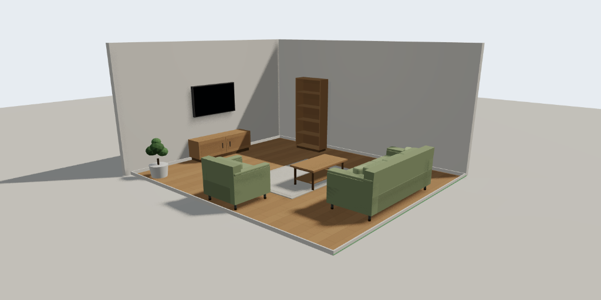

# RoomCraft — 3D Room & Furniture Planner

A browser-based room planner. Set a room to real dimensions, place furniture from
a 44-item catalog, and get a truthful answer to *"will this actually fit?"* —
with collision detection, circulation clearances, door-swing checks and
snapping, in a 3D viewport that runs at 60 fps with no assets to download.



Built with React 18, TypeScript, Three.js / React Three Fiber, Zustand, Tailwind
and Framer Motion. No backend, no accounts, no network calls.

```bash
npm install
npm run dev      # http://localhost:5173
```

---

## Contents

- [What it does](#what-it-does)
- [Three decisions worth explaining](#three-decisions-worth-explaining)
- [Architecture](#architecture)
- [Data model](#data-model)
- [Geometry: the rules everything obeys](#geometry-the-rules-everything-obeys)
- [Performance budget](#performance-budget)
- [Accessibility](#accessibility)
- [Security & privacy](#security--privacy)
- [Testing](#testing)
- [Scripts](#scripts)
- [Deployment](#deployment)
- [Scope: what is and isn't here](#scope-what-is-and-isnt-here)

---

## What it does

**Room** — custom width / length / height / wall thickness, in metres or feet
and inches. Doors and windows that attach to a wall and *stay* attached when the
room is resized. Wall colours and eight procedural floor finishes.

**Furniture** — 44 items across nine categories at real manufacturing
dimensions. Search, favourites, recently-used. Drag into the scene, or press
Enter on a card and it finds a free spot itself.

**Editing** — move, rotate, scale, duplicate, delete, lock, hide, group.
Snapping to walls, to other furniture edges and centres, to a grid, and rotation
in 15° / 45° / 90° increments. Undo/redo across 60 labelled operations. Full
keyboard operation including arrow-key nudging.

**Validation** — oriented-box collision, room boundaries, per-item circulation
clearances, and door-swing obstruction. Every problem names the object it
conflicts with.

**Views** — 3D orbit, top-down 2D, and a WASD walkthrough. Camera presets, live
day/night lighting driven by the room's actual windows, and a click-to-navigate
minimap.

**Output** — autosave with crash recovery, multiple projects, PNG export,
lossless JSON export/import, a printable design report with a costed shopping
list, and share links that carry the whole layout in the URL fragment.

---

## Three decisions worth explaining

### 1. Furniture is procedural geometry, not downloaded `.glb` files

Every model in [`builders.tsx`](src/components/canvas/models/builders.tsx) is
generated from its catalog dimensions at render time.

This is the largest deviation from a conventional R3F project, and it was chosen
on the merits:

- **Scaling stays honest.** A 1.5 m wardrobe is 1.5 m of *geometry*, not a fixed
  mesh stretched 25%. Its doors stay door-shaped and its plinth stays 80 mm.
- **Nothing to download.** First frame is immediate; there is no loading spinner,
  no Draco decoder, no 40 MB of assets in the repo.
- **No licence debt.** Nothing to attribute, nothing to re-check before shipping.
- **The catalog is the single source of truth** for both the collision rectangle
  and the visible mesh, so they cannot drift apart.

The trade is stylisation: these read as clean furniture *forms*, not photoreal
scans. The seam is a plain switch on `ModelKind` in
[`FurnitureModel.tsx`](src/components/canvas/models/FurnitureModel.tsx) — swapping
any single item for a real glTF touches one case and nothing else.

### 2. Undo/redo is snapshot-based, with explicit gesture boundaries

`commit(label, mutator)` clones the document onto a past stack. Snapshots are a
few hundred kB for a full room, and they make undo *trivially* correct — which
matters far more than the memory.

Continuous gestures would destroy that, so dragging and slider-scrubbing use
`beginGesture` / `mutateLive` / `endGesture`: one snapshot at the start, free
mutation during, one history entry on release. A 30-frame drag is one Ctrl+Z,
and a gesture that changed nothing leaves no entry at all. Both are tested.

### 3. Invalid placement explains itself instead of shaking

The original brief suggested a camera shake for invalid placement. This
implements a red outline **plus an inline label naming the conflict** —
"Overlaps with Sofa". Motion tells you something is wrong; text tells you what
to do about it, survives a screenshot into a bug report, and works for users who
cannot perceive the motion at all.

Severity is meaningful and separate:

| | Meaning | Blocked? | Example |
|---|---|---|---|
| **Error** | Physically impossible | Yes | Overlap, outside the room, larger than the room |
| **Warning** | Legal but a bad idea | No | No clearance to open a wardrobe; sofa in a door's swing |

---

## Architecture

```
┌──────────────────────────────────────────────────────────────┐
│  React UI (Tailwind + Framer Motion)                         │
│  TopBar · Catalog · PropertiesPanel · Overlays · Dashboard   │
└───────────────┬──────────────────────────────┬───────────────┘
                │ narrow selectors             │ registries
                ▼                              ▼
┌───────────────────────────────┐   ┌──────────────────────────┐
│  Zustand stores               │   │  capture.ts / pointer.ts │
│  ├ editorStore  document+undo │   │  one-way bridges out of  │
│  ├ uiStore      view+prefs    │   │  the WebGL canvas        │
│  ├ dragStore    live gesture  │   └──────────┬───────────────┘
│  └ projectsStore  library     │              │
└───────────────┬───────────────┘              │
                │                              ▼
                │                  ┌──────────────────────────┐
                │                  │  R3F / Three.js scene    │
                ├─────────────────▶│  Room · Openings ·       │
                │                  │  FurnitureItem ·         │
                │                  │  Lighting · CameraRig    │
                │                  └──────────────────────────┘
                ▼
┌──────────────────────────────────────────────────────────────┐
│  Pure utils — no React, no Three, fully unit-tested          │
│  collision · snapping · placement · units · roomGeometry ·   │
│  wallSegments · schema · shareLink · storage · exporters     │
└───────────────┬──────────────────────────────────────────────┘
                ▼
        localStorage  (projects + rolling autosave slot)
```

**Store split is deliberate.** `editorStore` holds only persisted domain state
plus selection, so changing the camera never dirties the document or lands in
undo. `dragStore` is separate again because it updates many times per second — a
drag re-renders the viewport, not the catalog or the top bar.

**The `utils/` layer is the interesting part.** It has no React and (except
`floorTexture`) no Three.js, which is why 126 tests cover the geometry, the
validator and the history model without ever mounting a component.

### Directory layout

```
src/
├── components/
│   ├── canvas/                    R3F scene
│   │   ├── Scene.tsx              assembly + placement evaluation
│   │   ├── Room.tsx               floor, walls, skirting, camera-aware fade
│   │   ├── Openings.tsx           door/window joinery + swing arcs
│   │   ├── FurnitureItem.tsx      hit testing, selection, drop-in animation
│   │   ├── Lighting.tsx           day/night tween, window light
│   │   ├── CameraRig.tsx          orbit, preset fly-to, walkthrough
│   │   ├── DragController.tsx     window-level pointer tracking
│   │   ├── Bridges.tsx            registers capture + floor picking
│   │   ├── Guides.tsx             snap guides, dimensions, invalid label
│   │   └── models/                procedural geometry
│   ├── ui/                        all DOM chrome
│   ├── Editor.tsx                 three-column shell + catalog drop target
│   └── ErrorBoundary.tsx
├── store/          editorStore · uiStore · dragStore · projectsStore
├── utils/          pure logic + colocated *.test.ts
├── data/           catalog.ts · finishes.ts
├── hooks/          useKeyboardShortcuts · useAutosave · useTheme
└── types/          the domain, with the unit and coordinate contracts
```

---

## Data model

```jsonc
{
  "id": "prj_m4k2x8abc123",
  "schemaVersion": 1,            // drives migration on load
  "name": "Living room",
  "unit": "m",                   // DISPLAY preference only
  "room": {
    "dimensions": {
      "width": 4.6,              // INTERIOR — the usable floor
      "length": 5.4,
      "height": 2.7,
      "wallThickness": 0.12
    },
    "walls": { "color": "#f5f4f0" },
    "floor": { "color": "#c69c6d", "pattern": "planks" },
    "openings": [
      {
        "id": "opn_a1",
        "kind": "door",
        "wall": "south",
        "offset": 2.3,           // metres along the wall to the CENTRE
        "width": 0.9,
        "height": 2.05,
        "sillHeight": 0,         // always 0 for doors
        "hinge": "left",
        "swing": "in"
      }
    ]
  },
  "furniture": [
    {
      "instanceId": "itm_m4k2x9def",
      "catalogId": "sofa-3",     // reference into immutable catalog data
      "position": { "x": 0, "z": 2.05 },   // footprint centre
      "rotation": 180,           // DEGREES, normalised to [0, 360)
      "scale": { "x": 1, "y": 1, "z": 1 },
      "finishId": "sage",
      "colorOverride": null,
      "locked": false,
      "visible": true,
      "groupId": null,
      "note": ""
    }
  ],
  "createdAt": 1739500000000,
  "updatedAt": 1739500900000
}
```

Catalog definitions are **immutable and never serialised** — a placed object
stores only a `catalogId`. That keeps saved projects small and means a catalog
price or mesh fix reaches every existing project for free.

---

## Geometry: the rules everything obeys

Four contracts, stated once and enforced everywhere:

**Units.** Every stored length is **metres**. `unit` is a display preference;
conversion happens only at the UI boundary in
[`units.ts`](src/utils/units.ts). Nothing else in the codebase knows what a foot
is. Input parsing accepts `3.5`, `350cm`, `12'`, `12' 6"` and `18"` in any field.

**Coordinates.** The room is centred on the world origin. Floor is the XZ plane
at `y = 0`, `+Y` is up. Local `+Z` is the direction an object faces. Rotation is
degrees about `+Y`, matching `three.js` `rotation.y` exactly.

**Room size is interior.** A 4 × 3 m room gives 12 m² of floor regardless of wall
thickness — what a builder quoting floor area means by "room size".

**Openings are parameterised along their wall.** An opening stores an `offset`
from the wall's start corner, never an XZ position. This is what keeps a door
attached to its wall when the room is resized; `reflowToRoom` re-clamps every
offset and every furniture position on any dimension change.

### Collision

Oriented rectangles via the **Separating Axis Theorem**, with an AABB
broad-phase in front. Axis-aligned boxes are not sufficient — a sofa at 30°
would claim a footprint far larger than the sofa, and objects that clearly miss
each other would report a collision.

Flush contact is explicitly *not* a collision (0.1 mm epsilon), so pushing a
wardrobe against a wall works. Objects in separate height bands may share a
footprint, which is how a monitor sits on a desk and a TV hangs over a console.

### Wall openings

Walls are cut by **construction, not CSG**: each wall emits solid boxes — piers
between openings, a sill below and a lintel above each one
([`wallSegments.ts`](src/utils/wallSegments.ts)). Boolean geometry would be
heavier, harder to keep watertight, and would need re-running on every frame
while a window's width is dragged.

The tests assert **area conservation** — segments + openings must exactly equal
the wall — which catches every realistic bug in that split.

---

## Performance budget

Documented target: **120 placed objects at 60 fps** on integrated graphics at
1440×900.

| Technique | Where |
|---|---|
| AABB broad-phase before SAT | `collision.ts` |
| Errors-only validation during a live drag | `Scene.tsx` |
| Drag state in its own store | `dragStore.ts` |
| Geometry memoised on shape-affecting fields only | `FurnitureModel.tsx` |
| Cushion geometry cached and LRU-bounded | `primitives.tsx` |
| Floor textures generated once, cached by (pattern, colour) | `floorTexture.ts` |
| Zero per-frame allocation in `useFrame` loops | `Room`, `Lighting`, `CameraRig` |
| Three.js split into its own chunk | `vite.config.ts` |

Placement evaluation is O(n²) over furniture. At 120 objects that is ~7k
rectangle tests, most rejected by the broad-phase — comfortably inside a frame.
If the budget ever grows, a uniform-grid broad-phase in `evaluatePlacement` is
the place to add it.

A three-step quality setting (High / Balanced / Fast) is exposed in **About &
diagnostics** and steps down soft shadows, shadow-map resolution, DPR and
antialiasing.

Production build: **~176 kB gzip** for Three.js, ~103 kB R3F, ~56 kB app.

---

## Accessibility

- **Drag-and-drop is never the only path.** Every catalog card is a button;
  Enter places the item at the first free spot.
- **Full keyboard operation** — arrow keys nudge (10 cm, Shift 50 cm, Alt 1 cm),
  `R` rotates, `Ctrl+D` duplicates, `Delete` removes, `1`/`2`/`3` switch views,
  `?` lists everything.
- **Colour is never the only signal.** Invalid placement is a red outline *and* a
  text reason; issues in the panel are prefixed "Error:" / "Warning:"; selected
  swatches carry a tick; locked objects show a badge and a panel notice.
- **Icon-only buttons cannot ship without a label** — `label` is a required prop
  on `IconButton`, not an optional one.
- **Dialogs** trap Tab, move focus in on open and restore it to the trigger on
  close.
- **`prefers-reduced-motion`** is honoured live, via a global CSS rule, a
  `MotionConfig` for Framer Motion, and explicit branches in the R3F loops
  (camera fly-to becomes a cut; the drop-in bounce is skipped).
- **Focus rings** are visible on every interactive element — restyled to be
  visible against the sage palette, never removed.
- Text contrast meets **4.5:1** throughout in both themes; the neutral scale
  bottoms out at `#71717a` on white (4.6:1) for secondary text.

---

## Security & privacy

Everything stays in your browser. No server, no accounts, no analytics, no
telemetry.

**Share links and JSON imports are treated as hostile input** — both are
attacker-controlled, and both funnel through the same validator,
[`schema.ts`](src/utils/schema.ts):

- every field is type-checked, range-clamped and re-derived
- colours must match `/^#[0-9a-f]{6}$/` — arbitrary strings never reach CSS or a
  shader
- text fields are length-capped so a hostile file cannot exhaust localStorage
- unknown `catalogId`s are dropped and reported, never rendered
- opening offsets are re-clamped, so "always fully on its wall" holds after any
  import
- a newer `schemaVersion` is refused outright rather than guessed at
- share payloads over 1 MB are rejected before parsing
- project ids are non-guessable (`prj_` + timestamp + 14 random chars)

The policy is **repair, not reject**: one bad furniture entry is dropped with a
warning rather than failing the whole file and losing the other 30 objects.

Share data lives in the URL **fragment** (`#s=`), so it is never sent to a web
server and stays out of access logs and `Referer` headers.

Storage failures degrade honestly: quota exhaustion surfaces a "Save failed"
state, an explanation, and a prompt to export a backup — never a silent loss.
The error boundary offers a JSON download before you reload, because the store
still holds your room in memory when a render throws.

---

## Testing

126 tests across 8 files, all pure — no component mounting, no WebGL.

```bash
npm test
```

| File | Covers |
|---|---|
| `collision.test.ts` | SAT vs rotated boxes, flush-contact epsilon, clamping, clearance shift |
| `units.test.ts` | round-trips, feet-and-inches formatting and parsing, junk rejection |
| `snapping.test.ts` | wall > furniture > grid priority, rotation steps, disabled config |
| `placement.test.ts` | overlap on both objects, height bands, clearance vs error, door blocking |
| `schema.test.ts` | hostile input, clamping, repair-not-reject, opening invariants |
| `shareLink.test.ts` | lossless round-trip, Unicode, oversized payloads, sanitisation |
| `wallSegments.test.ts` | **area conservation** across piers, sills and lintels |
| `editorStore.test.ts` | undo/redo, gesture collapsing, lock enforcement, save bookkeeping |

The suite is written against behaviour that would actually break for a user —
"a 30-frame drag is one undo step", "shrinking a room never leaves a wardrobe in
a wall", "flush placement is not a collision" — rather than against
implementation detail.

Verified manually in headless Chrome (WebGL via SwiftShader): dashboard →
template → editor renders, 44 catalog cards, drag/keyboard placement, `R`
rotation, undo, 2D/3D/night toggles, clearance warnings, and both colour themes,
with zero console errors.

---

## Scripts

| Command | Does |
|---|---|
| `npm run dev` | Vite dev server with HMR |
| `npm run build` | Type-check then production build |
| `npm run preview` | Serve the production build |
| `npm test` | Run the suite once |
| `npm run test:watch` | Watch mode |
| `npm run typecheck` | `tsc --noEmit` |
| `npm run lint` | ESLint, zero warnings tolerated |
| `npm run ci` | typecheck → lint → test → build |

---

## Deployment

Static output in `dist/` — any static host works. For Vercel: framework *Vite*,
build `npm run build`, output `dist`. No environment variables are needed,
because there is no backend.

---

## Scope: what is and isn't here

**Responsive behaviour is a deliberate scope decision, not a shortfall.**
Desktop-first, primary target 1280 px+. At 768–1279 px the sidebars become
drawers, closed by default, so the canvas keeps priority. Below 768 px a 3D
manipulation UI with 44-item drag-and-drop is the wrong interaction model, and
building a cramped version of it would be worse than not building it.

**Intentionally not implemented**, kept clearly separated from a stable core
rather than half-built:

- **Cloud accounts and sync.** The persistence layer is already isolated behind
  `storage.ts`; adding Supabase means implementing that interface plus per-user
  ownership checks. Doing it properly needs auth, access control and a deletion
  flow — real work, not a checkbox.
- **Real-time collaboration.** Stable instance ids and command-shaped operations
  are in place, but CRDT/OT conflict resolution is a project of its own.
- **AI layout generation.** The validator already computes everything a useful
  prompt needs (dimensions, openings, clearance violations, circulation). The
  missing piece is a preview-before-apply flow so every AI change stays undoable
  — which is the part that separates a useful feature from a gimmick.
- **WebXR / AR preview** and **glTF export** — scope-heavy, low overlap with the
  core planner.

**Known limitations:**

- Rectangular rooms only; L-shaped rooms would need the wall system generalised
  from four sides to an arbitrary polygon.
- PNG export captures the WebGL canvas only — UI overlays and dimension labels
  are excluded, which is what makes it usable as a presentation image.
- The design report opens a print window rather than shipping a PDF library; the
  browser already has one, and 400 kB to duplicate it is a poor trade.
- Catalog prices are indicative planning figures, not quotes.

---

## Licence

Furniture geometry is generated procedurally by this codebase — there are no
third-party 3D assets, and no model licences to track. Inter is loaded from
`rsms.me` under the SIL Open Font License.

## Author

**Saif Al Saad**

Software Engineering Student

Daffodil International University

Major: Software Quality Assurance & Testing (SQAT)
